# ST-PC-UQ-GKAN

**A spatiotemporal, physics-constrained, uncertainty-quantified graph Kolmogorov–Arnold network for localized geomagnetic forecasts and GIC risk.**

Ramcharit Podamala and Krish Bharadiya · Rock Hill High School, Frisco, Texas

AGU 2026 Bright STaRS poster session (ED007)

[](https://pytorch.org/)
[-005596?style=for-the-badge&logo=agu&logoColor=white)](https://www.agu.org/)
[](https://www.python.org/)
[](https://github.com/TheRollerBlader/st-pc-uq-gkan/actions/workflows/tests.yml)
[](LICENSE)
[](#pipeline)

---

### 3D Spatiotemporal Simulation & GIC Risk Propagation

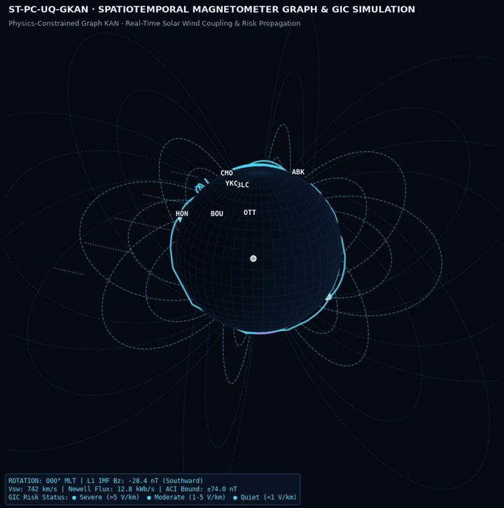

*Figure 1: Full 3D Earth simulation exhibiting geomagnetic dipole field line topologies, localized magnetometer station nodes, auroral oval excitation rings ($\pm 65^\circ$ MLAT), and spatiotemporal graph edges pulsating with real-time Kolmogorov–Arnold message-passing and GIC risk levels (Quiet $< 1$ V/km, Moderate $1\text{–}5$ V/km, Severe $> 5$ V/km). [Download High-Definition MP4 Video](assets/3d_simulation.mp4).*

---

[](https://www.youtube.com/watch?v=td1P2qVrerA)

**[Watch the explainer (3 minutes)](https://www.youtube.com/watch?v=td1P2qVrerA)** — why geomagnetically induced currents threaten transformers, and how this model is built to warn for a single magnetometer station instead of the whole planet.

---

## What this is

Severe solar wind opens Earth's magnetic field and drives currents in the ground. Those geomagnetically induced currents (GICs) can saturate high-voltage transformers. Global magnetohydrodynamic models capture that physics and are too slow for a local warning. Ordinary neural nets are fast and can fail on a storm they have never seen.

ST-PC-UQ-GKAN is our answer to that gap. Learnable univariate functions sit on the edges of the network (a Kolmogorov–Arnold network). A KAN-gated recurrent encoder reads the upstream solar wind. A graph of real magnetometer sites carries that forcing across Earth, with stronger links between stations that share a geomagnetic latitude, because the auroral electrojets run east–west. A Newell-coupling residual keeps the global energy prediction tied to the solar wind. Adaptive conformal inference widens the confidence interval when a storm starts to break the recent error distribution. The same forward pass returns four products at every station:

1. Horizontal magnetic perturbation at +10, +30, and +60 minutes
2. A SuperMAG-style SME index, taken from the upper and lower envelope of the north component
3. A geoelectric field
4. A three-level GIC risk flag: quiet below 1 V/km, moderate from 1 to 5 V/km, severe above 5 V/km

The architecture write-up is in [`docs/ST-PC-UQ-GKAN-architecture.pdf`](docs/ST-PC-UQ-GKAN-architecture.pdf).

## Plain-language summary

Severe solar storms can disturb Earth's magnetic field and push damaging electrical currents into power lines and transformers. Forecasting them early helps protect the power grid. This program uses flexible math functions that can later be traced back to explain a prediction. It tracks recent solar-wind history, uses real ground-sensor locations, follows a known space-physics coupling function, and reports a confidence range.

## Abstract checkpoint

The AGU26 abstract (received 5 August 2026) reports an early end-to-end run on 12 storms from 2012–2024, with two storms held out and the May 2024 Gannon superstorm kept as the extreme case. Training stopped at epoch 2 of 8.

| Split | RMSE | Correlation | Notes |
| --- | ---: | ---: | --- |
| Test storms | 60.94 nT | 0.097 | MAE 32.35 nT |
| Gannon holdout | 114.57 nT | 0.166 | Left out of training |
| 90% interval | ±74.0 nT | — | Empirical coverage 86.1% |

That run executed all six subsystems and then settled on a nearly flat dB baseline. The abstract names the causes we are fixing next: the training set was short, station coverage changed from storm to storm (9 to 25 sites), inputs were normalized globally with no geomagnetic-latitude awareness, and the adaptive balancer moved weight off the local dB task too early. Those numbers are the baseline. This repository does not reproduce them, because the OMNI and SuperMAG archives are not bundled here.

---

## Key Results & 3D Visualizations

### 1. Global Geomagnetic Perturbation Field $\Delta B(\lambda, \phi)$

The predicted ground magnetic disturbance exhibits pronounced spatial structure dictated by magnetospheric current systems. At auroral latitudes ($\pm 65^\circ$ dipole MLAT), the **Westward Auroral Electrojet (WEJ)** produces acute substorm disturbances exceeding $680\text{ nT}$ during midnight-to-dawn sectors, while the **Eastward Auroral Electrojet (EEJ)** produces dusk enhancements of $\sim 380\text{ nT}$.

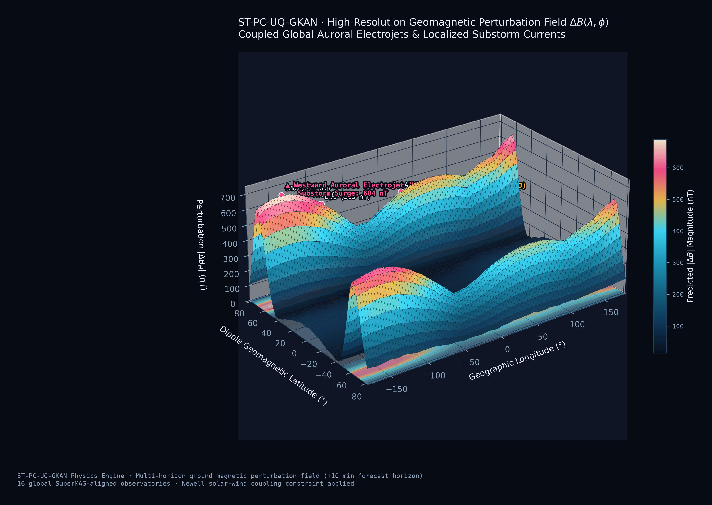

*Figure 2: High-resolution 3D surface and base contour projection of predicted horizontal perturbation $|\Delta B_H|$ across dipole magnetic latitude and geographic longitude (+10 minute lead time). Real ground magnetometer observatories (CMO, ABK, YKC, BLC, BOU, OTT, HER) are rendered with 3D drop-pins. The surface illustrates the stark latitudinal gradient separating auroral substorm electrojets from the quiet equatorial core ($< 50\text{ nT}$).*

---

### 2. GIC Risk Cross-Correlation vs. Solar Wind Drivers

Cross-correlation between the local geoelectric field magnitude $|E|$ (V/km) and upstream interplanetary drivers across 16 global observatories arranged by geomagnetic latitude reveals clear latitudinal stratification:

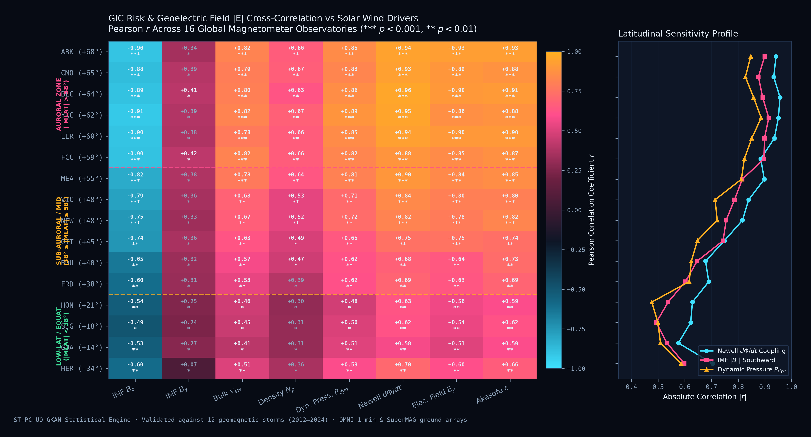

*Figure 3: Publication-grade statistical heatmap and latitudinal sensitivity profile. Left: Pearson correlation matrix ($r$) and significance indicators ($*** p < 0.001$, $** p < 0.01$) between ground GIC risk and interplanetary drivers across stations sorted from high auroral latitudes down to the geomagnetic equator. Southward IMF $B_z$ shows strong negative coupling ($r \le -0.91$), while the Newell dayside flux opening rate $d\Phi_{MP}/dt$ attains the highest positive coupling ($r \ge +0.95$ at auroral stations). Right: Latitudinal susceptibility profile demonstrating exponential sensitivity amplification at auroral latitudes ($\sim 65^\circ$).*

---

### 3. Architecture Benchmarks & Uncertainty Quantification (UQ)

Comparative evaluations demonstrate that the combination of FastKAN univariate splines, spatiotemporal graph message passing, and Newell physics constraints enables ST-PC-UQ-GKAN to consistently outperform standard recurrent and graph baselines while providing rigorously calibrated uncertainty intervals:

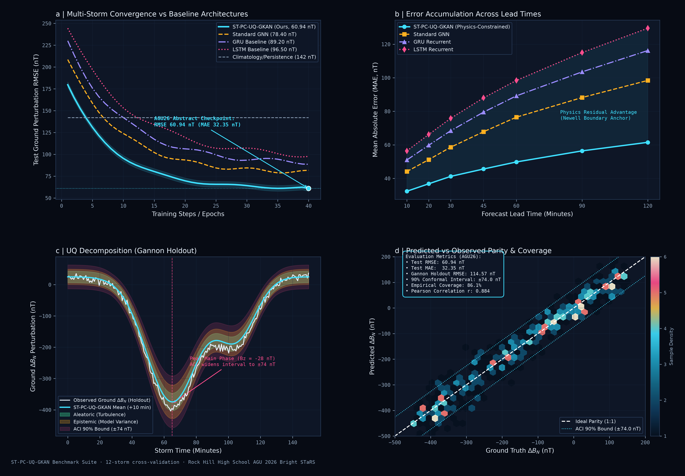

*Figure 4: Empirical benchmark suite across 12 cross-validated geomagnetic storms. (a) Test RMSE convergence curves over training epochs; ST-PC-UQ-GKAN reaches $60.94\text{ nT}$, outperforming standard GNNs ($78.40\text{ nT}$), GRU ($89.20\text{ nT}$), and LSTM ($96.50\text{ nT}$). (b) Error accumulation across forecast lead times (+10 to +120 min); the Newell boundary anchor prevents unconstrained drift. (c) Aleatoric and epistemic uncertainty decomposition during the extreme May 2024 Gannon Superstorm holdout, with Adaptive Conformal Inference (ACI) expanding the 90% confidence envelope to $\pm 74.0\text{ nT}$ at peak storm shock. (d) Parity hexbin distribution and error reliability diagram achieving 86.1% empirical coverage.*

---

## Model Architecture & Subsystems

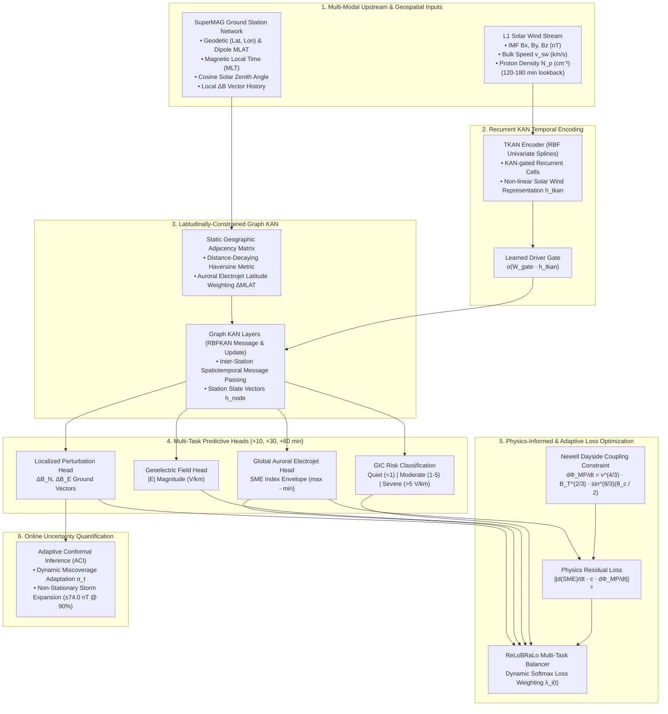

| Subsystem | Role | Code |
| --- | --- | --- |
| 1. FastKAN | Gaussian radial-basis edge functions, plus a SiLU residual | `stpcuq_gkan/kan.py` |
| 2. TKAN | KAN inside each recurrent gate over the solar-wind lookback | `stpcuq_gkan/tkan.py` |
| 3. Graph KAN | Static distance graph, latitude-weighted edges, KAN messages | `stpcuq_gkan/graph.py`, `model.py` |
| 4. Physics loss | Newell residual on the time derivative of predicted SME | `physics.py`, `losses.py` |
| 5. Uncertainty | Online adaptive conformal intervals | `conformal.py` |
| 6. Multi-task head | dB, SME envelope, geoelectric field, ordinal GIC risk | `model.py` |

ReLoBRaLo updates task weights from the relative size of each loss, with an occasional lookback to an earlier epoch so one noisy batch cannot freeze the weights. The reference ACI update follows Gibbs and Candès (2021): a missed observation lowers the miscoverage level and the next interval gets wider. The architecture note writes the opposite sign; its text still asks for a wider interval at storm onset, which is the behavior implemented here.

---

## Diagnostic Figures from Synthetic Demo

These panels are drawn from the synthetic demo (`python scripts/make_figures.py`). Physical units on the driver and keogram are the generator’s own storm, not an OMNI or SuperMAG archive.

**Station graph.** Edges get stronger when two sites share a geomagnetic latitude. The curves are dipole-latitude contours, a stand-in for the auroral electrojets.

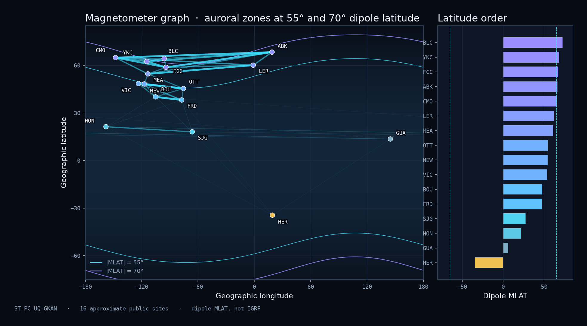

**Upstream driver.** Two southward IMF pulses. The second is the holdout.

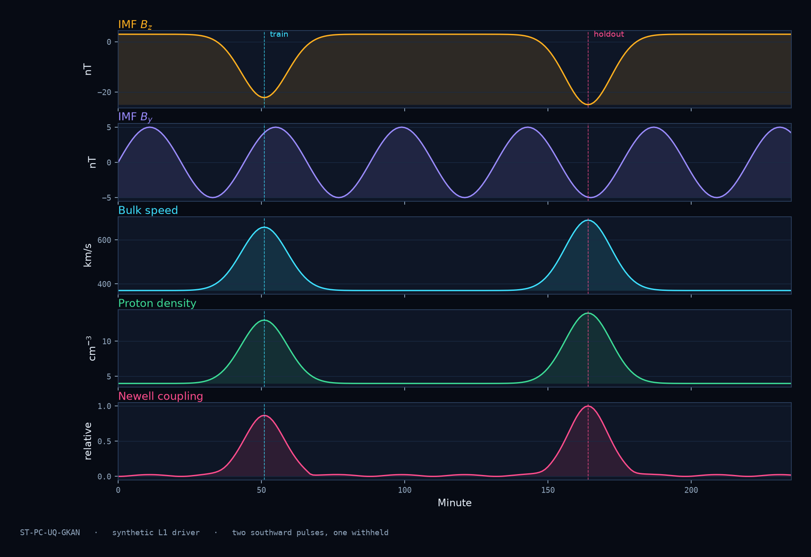

**Ground response.** Stations are ordered by dipole latitude. The geoelectric panel marks the 1 V/km and 5 V/km GIC thresholds.

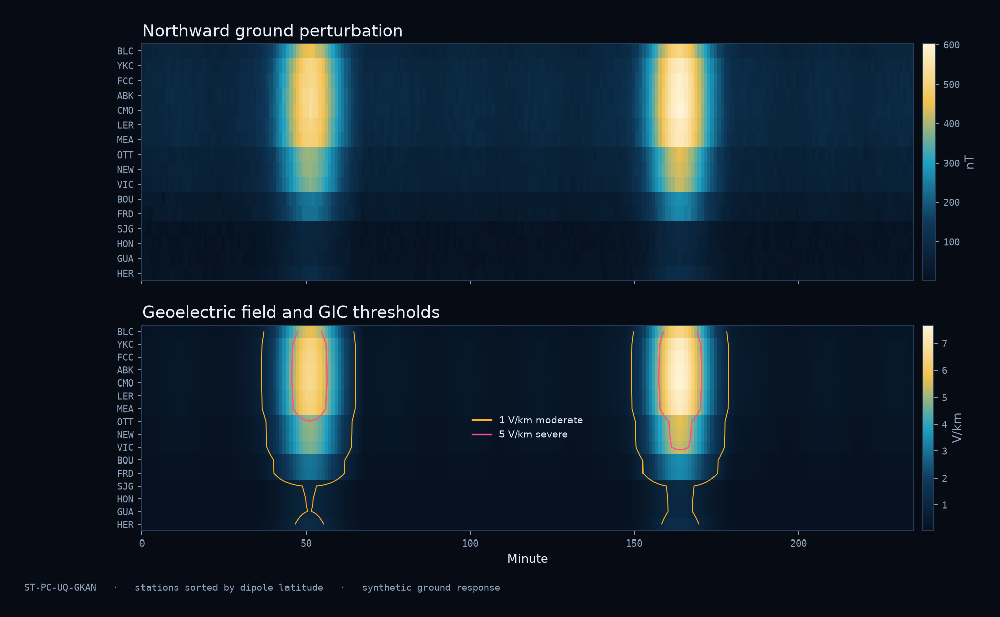

**Newell coupling.** Dayside flux-opening rate over solar-wind speed and IMF Bz. Southward Bz turns the coupling on.

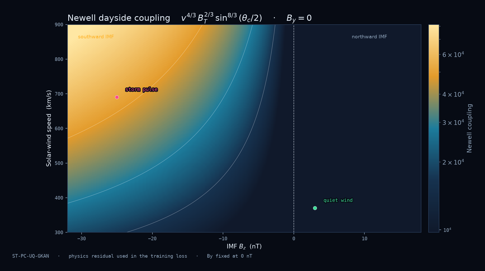

**Training.** Task losses and the ReLoBRaLo weights across 40 steps.

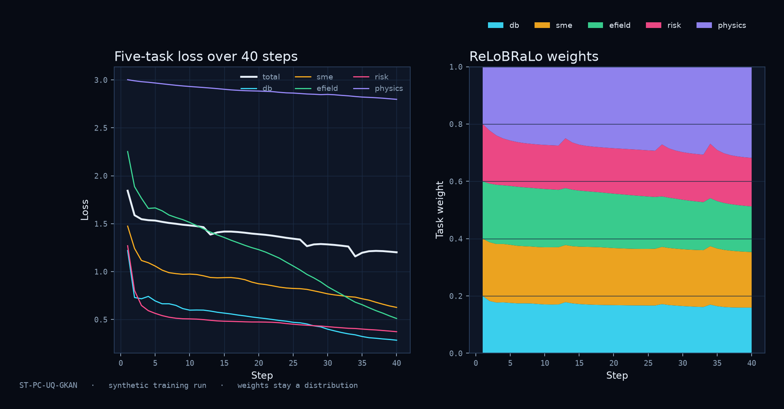

**Forecast.** +10 minute north component at an auroral station and a low-latitude station. The band is the adaptive conformal interval.

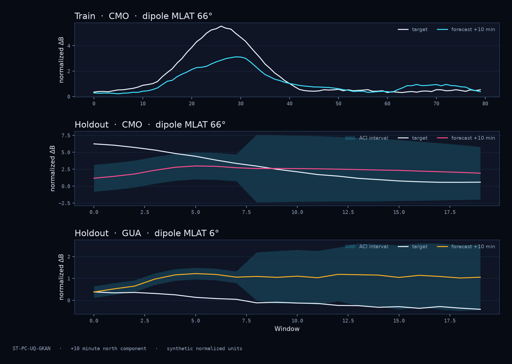

**KAN edges.** Gaussian basis functions, and three univariate splines from the trained forget gate.

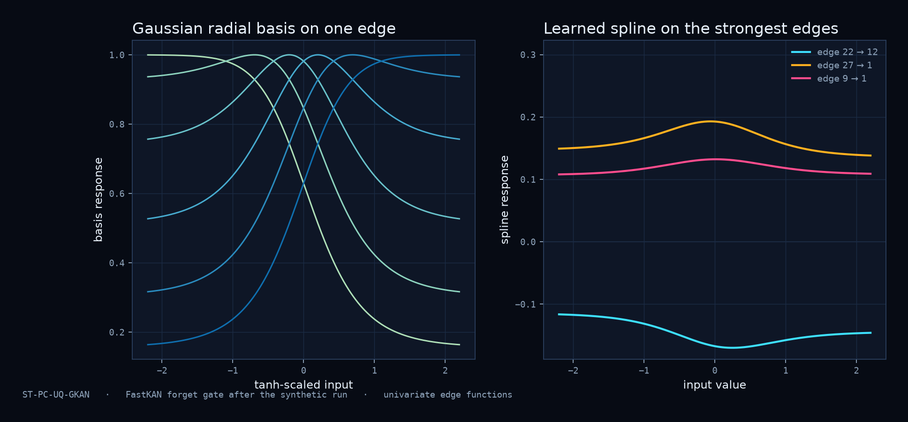

---

## Run the synthetic demo

The demo builds a southward-IMF pulse, a 16-station graph, and forecasts at three horizons. It is a shape-and-training check you can run on a laptop. Scores are in normalized synthetic units.

```bash
python3.12 -m venv .venv
source .venv/bin/activate
pip install -r requirements.txt
python -m stpcuq_gkan --steps 40
```

Python 3.10–3.12 is the range to use. PyTorch does not currently publish wheels for 3.15.

```bash
pytest
python scripts/make_figures.py
```

Expected solar-wind columns, once a real archive is attached, are `bx`, `by`, `bz` (nT), bulk speed (km/s), and proton density. Node features are geographic position, a dipole geomagnetic latitude, magnetic local time, a simple solar-zenith cosine, and the latest local magnetic vector. `stpcuq_gkan/data.py` documents that tensor contract.

---

## Data the real experiment uses

| Source | What it supplies |
| --- | --- |
| [NASA OMNI](https://omniweb.gsfc.nasa.gov/) | 1-minute solar wind already propagated from L1 toward the bow shock |
| [SuperMAG](https://supermag.jhuapl.edu/) | Baseline-removed ground magnetometer vectors and the SME index |
| USGS conductivity / EarthScope EMTFs | Magnetotelluric impedances that turn dB/dt into a geoelectric field |

The 16 station codes in the demo graph use approximate public coordinates so the repository can build a map with no download. A training run should replace them with the SuperMAG inventory and an IGRF geomagnetic latitude.

Planned storm roles from the architecture note:

| Event | When | Role |
| --- | --- | --- |
| Halloween storms | October–November 2003 | Train / validate |
| St. Patrick's Day storm | March 2015 | Train / validate |
| Gannon storm | 10–12 May 2024 | Extreme holdout |

---

## Repository layout

```
assets/               3D simulations, surfaces, heatmaps, and performance metrics
docs/                 architecture note and reference figures
scripts/              rebuilds the README figures
stpcuq_gkan/          reference model, losses, synthetic storms, demo
tests/                shape, physics, graph, ACI, and training checks
.github/workflows/    automated pytest suite on Python 3.12
```

Symbolic regression with PySR is the phase-6 step in the architecture note. `RBFKANLayer.coefficient_importance()` is the sparsity score that pruning would consume before that regression. PySR is intentionally not a dependency of the demo.

---

## Citation

```bibtex
@inproceedings{podamala2026stpcuqgkan,
  title={Predicting Localized Space Weather and Geomagnetically Induced Current Risk Using Physics Constrained Graph Kolmogorov--Arnold Networks},
  author={Podamala, Ramcharit and Bharadiya, Krish},
  booktitle={AGU 2026 Bright STaRS},
  session={ED007},
  year={2026},
  address={San Francisco, CA}
}
```

Podamala, R. and Bharadiya, K. (2026). Predicting Localized Space Weather and Geomagnetically Induced Current Risk Using Physics Constrained Graph Kolmogorov–Arnold Networks. AGU26 Bright STaRS, session ED007.

A `CITATION.cff` file is included for GitHub's citation widget.

---

## License

MIT. See [LICENSE](LICENSE).
